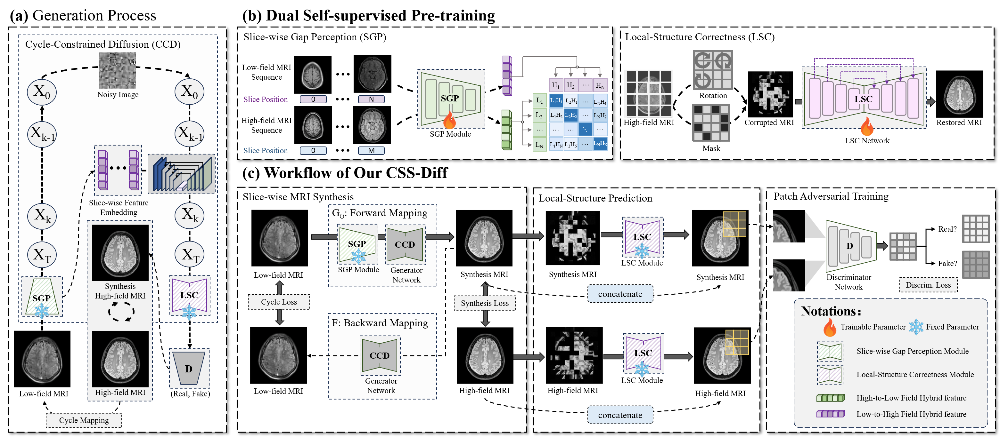

# CSS-Diff: Cyclic Self-Supervised Diffusion for Ultra Low-field to High-field MRI Synthesis

This repository provides the code accompanying the manuscript:

> **Cyclic Self-Supervised Diffusion for Ultra Low-field to High-field MRI Synthesis.**  
> Zhenxuan Zhang*, Peiyuan Jing*, Zi Wang, Ula Briski, Coraline Beitone, Yue Yang,  
> Yinzhe Wu, Fanwen Wang, Liutao Yang, Jiahao Huang, Zhifan Gao, Zhaolin Chen,  
> Kh Tohidul Islam, **Guang Yang†**, **Peter J. Lally†**  
> (* equal contribution, † corresponding authors)

---

## Overview

Low-field MRI (≤ 0.5T) is attractive due to its lower cost, portability, and accessibility, but typically suffers from reduced SNR, lower spatial resolution, and degraded anatomical fidelity compared to high-field MRI. These limitations hinder its clinical utility.

To address this gap, we propose **CSS-Diff (Cyclic Self-Supervised Diffusion)**, a diffusion-based framework that synthesizes high-field-like MRI from real low-field inputs while aiming to preserve anatomical structure and reduce hallucinations.

CSS-Diff incorporates:
- **Cycle-Constrained Diffusion (CCD)** to enforce bidirectional consistency and stabilize generation,
- **Slice-wise Gap Perception (SGP)** to improve inter-slice coherence, and  
- **Local-Structure Correctness (LSC)** to refine fine-grained anatomical details.

---

## Framework (Fig. 2)



**Figure 2.** Schematic of the CSS-Diff framework.  
- **CCD** enforces cycle consistency along the diffusion trajectory.  
- **SGP** models slice-wise relationships to mitigate through-plane inconsistencies.  
- **LSC** performs patch-level structural correction to enhance local fidelity.  
- The overall pipeline integrates diffusion-based synthesis with local structural refinement and patch-level adversarial training.

---

## Repository Structure

CSS-Diff/
├── models/ # Network architectures (SGP, LSC, diffusion modules)
├── datasets/ # Data loading and preprocessing
├── options/ # Training and testing configurations
├── train.py # Training script
├── test.py # Evaluation script
├── scripts/ # Utility scripts
├── requirements.txt # Dependencies
├── fig2_r1.png # Main framework figure
└── README.md # This file


---

## Getting Started

The engineering repair and remaining paper/code gaps are documented in
[implementation status](docs/IMPLEMENTATION_STATUS.md). Independent path loss and
paper-metric reproduction are not yet verified.

### Environment

The repair checks used Python 3.8 and PyTorch 2.1.2. Install a compatible PyTorch /
torchvision pair for your machine, then `pip install -r requirements.txt`.
`pss_environment.yml` records the historical environment; it is not a portable lockfile.

### Data and weights

Prepare grayscale PNG slices in `train_A`, `train_B`, `val_A`, `val_B`, `test_A`,
and `test_B` beneath your data root. A is LF, B is HF. The aligned loader pairs
sorted numeric suffixes (e.g. `low_field_0.png`, `high_field_0.png`); use equal counts
and verified correspondence. No raw patient data is supplied.

Obtain the required SGP/LSC weights as described in [checkpoints](docs/CHECKPOINTS.md).
Edit the YAML paths or pass CLI overrides. Missing weights fail explicitly.

### Single training run

```bash
python train.py --config train_configs/train_pss_templete.yaml \
  --dataroot /path/to/mri --name css_diff --wdb_disabled \
  --sgp_weights /path/to/clip_1.pth \
  --lsc_weights /path/to/unet_weights_rotate.pth
```

`pss_train.py` is an alias of the same entry point. `--name` is respected.
For CPU, pass `--gpu_ids -1`. To start a W&B sweep explicitly, set
`wdb_disabled: false` in a copied YAML and pass `--sweep`.

To initialize from saved training network weights, add `--continue_train --epoch latest`
and set `--epoch_count` appropriately. This does not restore optimizer or RNG state.

### Bidirectional evaluation

```bash
python test.py --config test_configs/test_pss_templete.yaml \
  --dataroot /path/to/mri --name css_diff --epoch latest \
  --sgp_weights /path/to/clip_1.pth \
  --lsc_weights /path/to/unet_weights_rotate.pth
```

Place G_A/G_B files under `checkpoints/css_diff/`. Both test_A and test_B are
required; this entry point is not verified for LF-only deployment. Use the matching
training architecture and diffusion settings for your checkpoint.

### Regression checks

```bash
python -m unittest discover -s tests -v
```

## Data
Raw MRI data is not included in this repository due to privacy and licensing restrictions. Please contact the corresponding authors for collaboration inquiries.

## Citation
If you use this code, please cite our work:

@article{zhang2025cyclic,
  title={Cyclic Self-Supervised Diffusion for Ultra Low-field to High-field MRI Synthesis},
  author={Zhang, Zhenxuan and Jing, Peiyuan and Wang, Zi and Briski, Ula and Beitone, Coraline and Yang, Yue and Wu, Yinzhe and Wang, Fanwen and Yang, Liutao and Huang, Jiahao and others},
  journal={arXiv preprint arXiv:2510.13735},
  year={2025}
}

## Contact
Zhenxuan Zhang — z.zhenxuan24@imperial.ac.uk

Guang Yang — g.yang@imperial.ac.uk

Department of Bioengineering, Imperial College London
